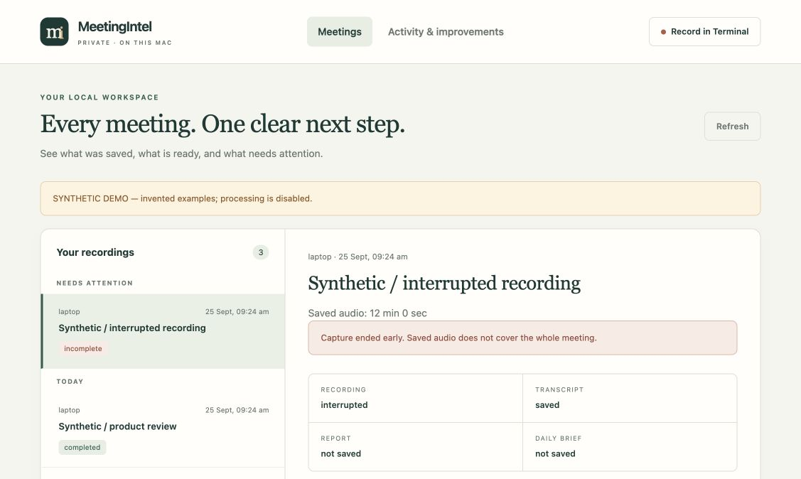

# MeetingIntel

[](https://github.com/St-Gonne/meeting-intelligence-system/actions/workflows/public-source.yml)

Record a meeting on your Mac, or bring in recordings from your phone. Transcribe
locally, keep speaker turns, and get a detailed report and a shorter daily brief.
The inbox shows recording, transcript, report and brief status separately.

This is an early public application for people comfortable with Python and local
models, including people using a coding AI to help with setup. Demos work without
models or accounts. Real processing needs your own tools, models and permissions.



*The screenshot shows the synthetic demo. Processing is disabled in that demo.*

## Start with your AI

Give your coding AI the repository and this instruction:

> Read AGENTS.md and docs/AI_SETUP.md. Check my computer, help me run the demos,
> then set up the laptop and/or phone workflow I choose. Finish with a short
> tutorial and command sheet using my actual commands and folders. Tell me which
> steps passed and what still needs my input.

The [AI setup guide](docs/AI_SETUP.md) and [setup instructions](docs/SETUP.md)
cover dependency installation, model downloads, saved settings, one-service
Ollama and verification. You complete account login, model terms and OS permissions.

## Try the demos

Python 3.11 on macOS or Linux is enough:

```sh
git clone https://github.com/St-Gonne/meeting-intelligence-system.git
cd meeting-intelligence-system
python3.11 scripts/setup_check.py --mode demo
python3.11 app/mi help
python3.11 app/demo_ui.py
```

The inbox uses invented items. Press Ctrl-C to stop it. Then try the optional
Voice ID lifecycle, using invented vectors rather than actual voices:

```sh
python3.11 app/demo_voice_id.py
```

[First-run walkthrough](docs/FIRST_RUN.md) · [Tutorial](docs/TUTORIAL.md) ·
[Command sheet](docs/COMMANDS.md) · [Current status and limits](docs/STATUS.md)

## What the current application does

| Part | Behavior |
|---|---|
| Laptop capture | Guarded OBS recording, checksum manifest, clean stop and explicit processing |
| Phone intake | Read-only Drive download, settlement, grouping review and canonical audio |
| Transcription | Qwen defaults for phone/guarded laptop; explicit Whisper option; Meetily keeps Whisper |
| Speaker handling | Retains aligned word-speaker changes and timestamps; tied overlaps remain unknown |
| Analysis | Local report and daily brief; observed labels own actions, names stay outside model prompts |
| Recovery | Preserves raw audio, validates exact sources and reuses accepted completed transcription stages |
| Queue | One approval for today's ready set, sequential processing, saved status and deliberate retries |
| Runtime | One managed Ollama service by default; optional shared-GPU coordination |
| Optional owner matching | Separately calibrated enrollment, consent, revocation and machine-match provenance |

The November refresh brings the recent speaker export, numeric timestamp,
overlap, Qwen window/reuse, stop/recovery and delivery fixes into the public code.
It also adds setup guidance for humans and coding AIs. See [CHANGELOG.md](CHANGELOG.md).
These changes preserve evidence more faithfully; they do not prove perfect speaker
separation, recognition or transcription on every call.

## Everyday use after setup

```sh
mi ui                         # Local inbox
mi record                     # Laptop capture; Ctrl-C to stop; keep lid open
mi sync                       # Download phone recordings; no processing
mi sync status                # Check delivery and settlement
mi inbox                      # Review grouping / select exact processing
mi queue today                # Preview today's ready set; y approves
mi queue status               # Read saved queue state
mi queue resume               # Continue already approved pending work
mi --transcription-backend whisper inbox  # Explicit alternative to Qwen
```

The launcher reads ignored `app/.local/settings.json`; your AI can configure actual
paths, timezone and backend there. Recordings and results remain on your computer;
phone uploads also live in your chosen Drive account. No meeting data, credentials,
voice enrollments or model weights ship in the repository.

Full processing targets **Apple Silicon macOS**. Demos/core tests support
macOS/Linux; Windows and full Linux capture/processing are unproven. A complete
second-machine recording-to-report setup and universal minimum RAM remain unproven.
Start with a short trial before relying on a long meeting.

Phone support currently covers the known Android ASR Voice Recorder `.m4a`
in-person lane. It does not capture cellular/VoIP calls. Follow [phone setup](docs/PHONE_SETUP.md)
for recorder upload, read-only Drive authorization, settlement and grouping.

Voice ID is optional and disabled on a new install. Anonymous notes do not require
it. A new owner needs their own evaluation and enrollment; no author calibration
or voiceprint is included. [Voice ID guide](docs/VOICE_ID.md).

## Contributing and verification

```sh
python3.11 -m venv .venv
.venv/bin/python -m pip install -r requirements-test.txt
.venv/bin/python scripts/test_public.py
```

On Linux add `--portable`. Tests use temporary state and synthetic fixtures/fake
model servers. Process-lifecycle checks require process inspection. Optional
upstream speaker-writer integration checks need the separate runtime; skips are
reported. Tests alone do not establish live capture or model quality.

[Contributing](CONTRIBUTING.md) · [Validation](docs/RELEASE_VALIDATION.md) ·
[Report a first run](https://github.com/St-Gonne/meeting-intelligence-system/issues/new?template=first-run.yml) ·
[Open issues](https://github.com/St-Gonne/meeting-intelligence-system/issues)

The application and current developer docs use [MIT](LICENSE.md). Model weights
and dependencies have their own terms. Earlier historical architecture documents
retain their existing terms. The separate [phone-ingestion toolkit](https://github.com/St-Gonne/meetingintel-phone-ingest)
is Apache-2.0. Source provenance is in [SOURCE_MANIFEST.json](docs/SOURCE_MANIFEST.json).
